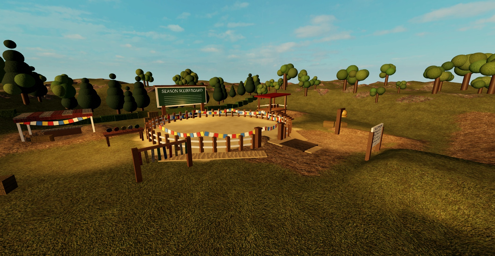
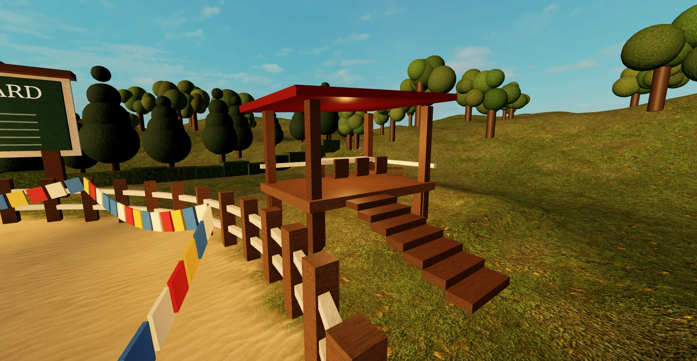
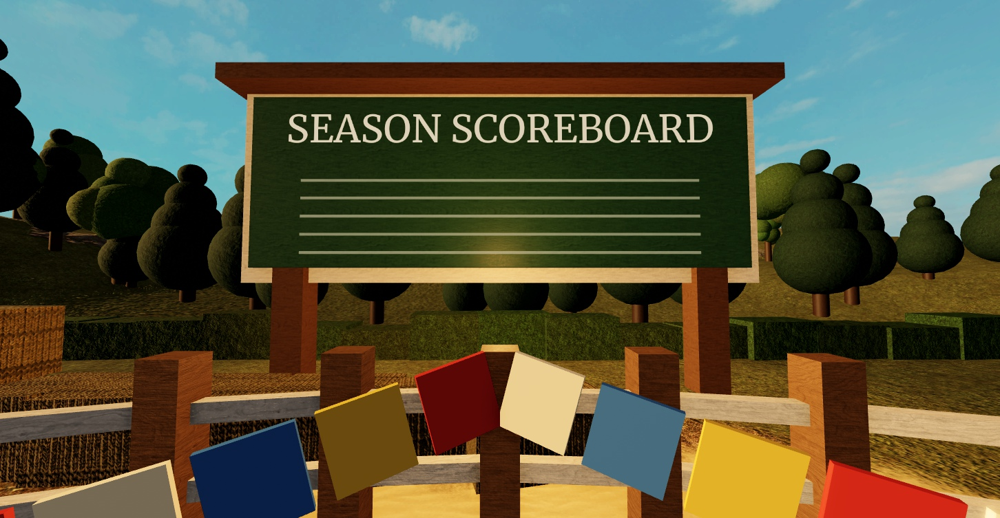
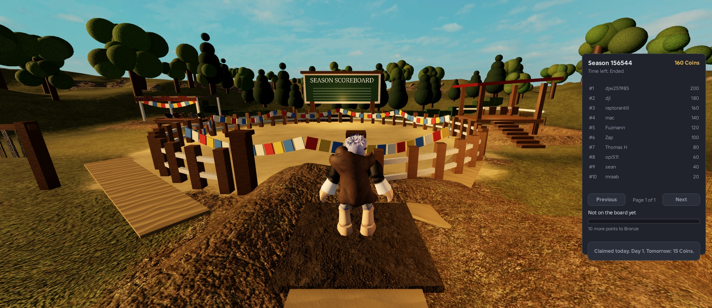
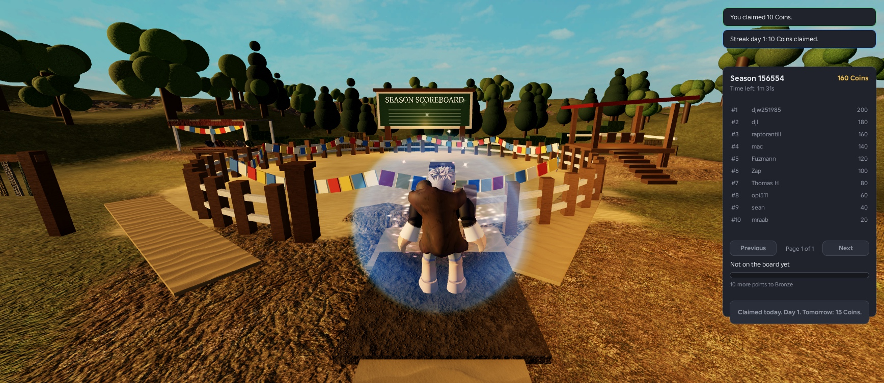

<div align="center">

# tally

Seasons, leaderboards and season-end rewards for Roblox, with each reward paid exactly once across servers and crashes (proven against Lune fakes). It leaves out the game's scoring rules, reward art and anything a player does with Coins. Player data is saved with a session lease, the same store as [satchel](https://github.com/Provokke/satchel).

    

Refer to [LICENSE](LICENSE) for the legal bits.

</div>



## What's in it

- **Seasons that end once.** A season is one DataStore key (`season/<id>`, never deleted). Ids come from the config (`floor((now - Epoch) / SeasonLengthSeconds) + 1`, 14 days from 1 January 2026 UTC by default), but a clock only says which season a server believes is current. It never ends one. A season ends by a stored close write, and the first close wins.
- **Rewards paid exactly once.** Everyone who scored in a season is paid on whichever server they next join, even if the server that closed it has died. The reward Coins, the `rewarded` flag, the tier and a notice all go into one profile save, so a crash before the save pays nothing and a crash after it pays once.
- **Tiers and a podium.** The highest tier whose `min` the player's own score meets pays its Coins (Bronze 10, Silver 50 and Gold 150 points in the shipped config). The top `PodiumSize` (3) at the close also earn a podium bonus. Tiers come from the player's own record and don't depend on ranks.
- **Server-only scoring.** There is no remote that takes points. The game's own server code calls `TallyRecord` (a BindableFunction in ServerStorage) with a number it decided. A call is refused for a bad amount (not a whole positive number, or over `MaxPointsPerCall`), a season that has ended, a season already paid or a season the server has seen closed. Two modes: `sum` adds every submission, `best` keeps the highest single one.
- **Lifetime stats are never touched.** A new season, a close or a payout leaves a player's lifetime totals alone.
- **The leaderboard is a view.** One OrderedDataStore per season (`tally-<id>`) is written from the profile on a timer, not on every point. Browse reads it through a per-server cache that refreshes at most every `BoardRefreshSeconds` (15). The ordered store is read once to freeze the podium at the close and never to decide a reward amount.
- **Daily streak.** One claim a day, with the day counted in UTC (`floor(os.time() / 86400)`). The next day continues the streak, any later day restarts it at 1, and a claim for today or earlier is refused. Rewards are `StreakRewards` by count, capped at the last entry. The claim, the Coins and the new streak go in one save.
- **Server authority.** Clients send intent only (`claim_streak` or `board_page`). Every call is checked for type and range, rate limited per player and answered in plain words. A claim also draws from a slower store allowance, so a loop of calls can't use up the write budget.
- **Scoreboard panel.** The current season, time left, the top 10 with paging, your rank and tier progress, a streak button and a toast for each notice.

```lua
-- src/shared/Config.luau
Tiers = table.freeze({
	table.freeze({ name = "Bronze", min = 10, coins = 50 }),
	table.freeze({ name = "Silver", min = 50, coins = 150 }),
	table.freeze({ name = "Gold", min = 150, coins = 400 }),
}),
```

## The one rule

**A season's outcome is decided by one stored write, and a player's reward is applied in the same profile save that records it was paid.**

The season key is the single source of truth about how a season ended. The player's profile is the single source of truth about what they scored and what they have been paid. The ordered store is a cache.

## How a season ends and pays

- **Record: server only.** `Tally.record` raises the profile's score for the current season and the lifetime total. The score is pushed to the ordered store on a timer. While the previous season is not known closed (or is still inside `CloseGraceSeconds` of its end) the push also writes the player's score in that season, so a score made in the last push interval still reaches the board the close reads.
- **Close: one write.** Once a season is past its end by `CloseGraceSeconds` (60) on the closing server's clock, a server reads the top entries and writes `close` through `UpdateAsync`. The write refuses a season that is missing, not open or not yet ended. Running it again refuses `not_open`, so every later closer reads the stored podium and decides from that.
- **A server with a slow clock waits.** It can't close early, and its late `record` is refused once the profile has been paid.
- **Payout: one save.** For each season in the profile that has a score, isn't paid and is older than the current one, the server decides from the closed season key: the tier from the player's own score, plus the podium bonus if they are on the stored podium. It applies the Coins, sets `rewarded` and `tier`, adds a notice and saves once, bound to the live session's profile. If the save fails, the change is put back and the next settle tries again.
- **No board, no podium.** If the board can't be read, a close waits up to `PodiumWaitSeconds` (an hour) past the end and then closes without a podium. Tier rewards are unaffected.
- **When it runs.** Settle runs on join and then every `SettleSeconds` (60) for each player, behind a per-player lock so two settles can't overlap.

### What a crash does

- **Before the close write:** nothing shared has been written, and the next server closes it.
- **After the close write, before a payout save:** the season is closed with its podium, so the next settle pays from it.
- **After the payout save:** `rewarded` is stored with the Coins, so nothing is paid twice.

## 🎮 Demo place

`demo/tally.rbxl` is a ready-made place: a country-show ring with a judges' stand and a painted scoreboard sign. Open it in Studio and press Play. In Studio the server uses in-memory stores, and the `TallyDemoSeason` attribute on ServerStorage shortens a season to 3 minutes. The `TallyDemoSeed` attribute seeds ten pretend players on the board and one finished season in which you scored 85 points, so the first settle closes it and shows a reward toast. The scoreboard panel is on screen, and `demo/DemoGame.server.luau` wires three prompts in the ring (the bell for 5 points, the ribbon for 10 and the judges for 25, with a 10 second cooldown) to the server-only `TallyRecord` call.

To use the real DataStore, set the attribute `TallyUseDataStore` to true on ServerStorage and turn on API access for the place.

| The show ring | The judges' stand |
|---|---|
|  |  |
| **The scoreboard sign** | **The live board** |
|  |  |



- Studio runs one server, so the demo can't show two servers closing a season. The seeded finished season is minted for the demo and is not part of the conservation claim. An in-memory store forgets everything when the play test stops, so coming back after a rejoin isn't shown either. The specs cover both.

## 🏗️ Architecture

```
                     Player joins / leaves / autosave / shutdown
                                   |
                                   v
 init.server.luau  ------->  Sessions  ---->  Store  ---->  Lease (claim / refresh / release)
 (services, remotes,                            |    ---->  Migrations + Steps
  poll, demo seed)                              |    ---->  Profile (coins, lifetime, seasons, streak, notices)
        |                                       v
        |                                  DataStore  (in-memory in Studio)
        |
        |  Request (RemoteEvent)                Sync (RemoteEvent)
        |  <---------------------------------   ------------------>
        v                                                       client
   Handlers  -- Validate, RateLimiter ---> Tally ---> Season, Scores, Payout, Streak (pure)
                                             |
                                             +--->  Leaderboard (ordered stores, a cache)
```

The write order that matters:

```
1. close     one UpdateAsync on season/<id>, running the pure Season.close transform
2. payout    decide from the closed season, apply to the profile, one save
             (the ordered store is written on a timer and is never read to decide a reward)
```

```
src/
  server/
    init.server.luau   services, remotes, the settle and season loops, autosave and shutdown, demo gate
    Sessions.luau      session lifecycle on one server: load, release, autosave, saveNow, shutdown wait
    Tally.luau         record, push, settle and claimStreak, behind a lock per player
    Season.luau        pure: season ids, windows, open and close transforms
    Scores.luau        pure: whether a score may be recorded, and the new totals
    Payout.luau        pure: what a closed season pays a profile
    Streak.luau        pure: the daily streak claim
    Leaderboard.luau   the ordered-store cache: timed writes, one cached read per refresh window
    Notices.luau       plain-words notices kept in the profile
    Handlers.luau      validates and rate limits every client request, one at a time per player, then syncs
    DemoSeed.luau      Studio-only seeded board and finished season
    Data/
      Lease.luau       claim, refresh and release transforms
      Migrations.luau  upgrades saved data one schema step at a time
      Steps.luau       the migration steps
      Profile.luau     what a new profile holds, and how it is encoded for storage
      Store.luau       loads, saves and releases sessions over a DataStore
      MemoryStore.luau in-memory stand-in with the same UpdateAsync contract, used in Studio
      MemoryOrderedStore.luau in-memory stand-in for the ordered stores, used in Studio
  shared/
    Config.luau        seasons, tiers, podium, streak, limits, timings: the one place to edit
    ConfigCheck.luau   refuses to start the server on a bad config
    BoardLogic.luau    the panel's pure rules: time left, rank and tier text, plain-word replies
    RateLimiter.luau   token bucket per player
    Validate.luau      type and range checks for remote arguments
  client/
    init.client.luau   wires Sync and the requests
    Board.luau         the scoreboard panel
    Theme.luau         colours and small UI helpers
demo/
  DemoGame.server.luau three prompts that score through TallyRecord
```

## 🚀 Quick start

```
rokit install
rojo serve
```

Or open `demo/tally.rbxl` and press Play.

The tools are pinned in `rokit.toml`: Rojo 7.4.4, Lune 0.8.9, StyLua 2.0.2 and Selene 0.27.1. To start from an empty baseplate, connect the Rojo plugin and press Play. Score from your own server code:

```lua
local record = game:GetService("ServerStorage"):WaitForChild("TallyRecord") :: BindableFunction
local accepted, reason = record:Invoke(player, 10)
```

To change the season length, tiers, podium or streak rewards, edit `Config.luau`. The server refuses to start on a bad config.

In Studio the server uses an in-memory store and in-memory ordered stores, so the place runs unpublished and nothing is saved between plays. To use the real DataStore, set the attribute `TallyUseDataStore` to true on ServerStorage and turn on API access for the place. To watch a season start to finish, set `TallyDemoSeason` to true, and to fill the board in Studio, set `TallyDemoSeed` to true.

The checks CI runs:

```
stylua --check src tests
selene src
cd tests && selene .
lune run tests/run
lune run tests/mutate
lune run tests/mutate -- --self-check
rojo build -o build/tally.rbxl
```

## 🧪 Testing

```
lune run tests/run
```

348 tests, all passing:

- Pure rules (Season, Scores, Payout and Streak): every refusal, the season window maths, tier and podium decisions, and the streak's continue, restart and same-day cases.
- Tally scoring, settle and streak: the rules applied to a profile, including a failed save rolling back and a season that can't pay until it is closed.
- Races: two servers closing the same season with different podium views (the first write wins and both pay from the stored podium), a server whose clock is behind, and a rejoin on another server mid-payout, each with a negative control.
- Crash at every write: crash injection at every write of the close, the payout save, the streak save, the leaderboard write, autosave and release, in both modes (the server stops with the write unapplied, or the write lands and its answer is lost). After each, the servers restart over the stored records and a conservation check counts rewards, Coins and lifetime stats. The negative controls break the walk's own guarantees and each must fail it.
- Session conservation: the same checks through the real `init.server.luau`, Sessions, Store and Lease over stand-in services, including a leave and rejoin mid-settle, a lease taken by another server mid-settle, a leave mid-settle and a shutdown with a hung save.
- Budget: Browse makes at most one ordered-store read per refresh window per server, and a client can't trigger a settle more than once per poll.
- Server script: the real `init.server.luau` over a small stand-in for the Roblox services (`tests/fakes/FakeGame.luau`): a bad config refuses to start, a joining player is synced, a streak claim and a payout go through the remotes, bad requests are dropped and the unpublished-place fallback works.
- Handlers, Validate and Rate limiter: bad arguments dropped, range edges, the rate limit and the store allowance, and `busy` and `slow_down` answers.
- Leaderboard and ordered stores: timed writes, the one-read-per-window cache and the fake ordered store's lag before a write is visible to a sorted read.
- Data layer: Lease, Migrations, Profile, Store (loads, saves and leases), Sessions, the in-memory stores and the fake data store.
- Board logic, Config checks, Notices and Demo seed: the panel's plain words, each config rule failing when broken, notices capped at `NoticeCap`, and the seed planning the same board every time.

Every race and crash spec has a negative control: a deliberately broken version that must fail it.

**Mutation runner.** `lune run tests/mutate` applies each of the 30 patches in `tests/mutants` to a throwaway copy of `src` and `tests`, runs the full suite there and requires a failure. The mutants break one behaviour each, among them: a close without the not-ended check, a payout from a clock read with no close write, a reward without the paid flag, the paid flag in a separate save, a record after the season is paid, the streak's same-day check loosened, a save not bound to the profile, Browse with no refresh cache, and a podium read from the live board instead of the stored one. A mutant that survives, or whose find text no longer matches (stale), or that breaks the build, fails the run. `lune run tests/mutate -- --self-check` proves the runner itself. Currently 30 killed, none surviving.

The client script and the UI can't run under Lune. They build with Rojo and are checked in Studio. The stand-in the server script runs on models only the members it uses, but it is not Roblox. The runner counts a test that yields and never finishes as a failure, so a hung test can't end the run with no output.

## ⚠️ Honest limits

- Saving has only been tested against a fake data store in Lune. None of it has run against a real Roblox DataStore or OrderedDataStore yet, so throttling, outages and real request budgets are unproven. No live-server DataStore run has been verified.
- **Proven against fakes, not Roblox.** Season close, payout and crash recovery are proven against Lune fakes only, not on Roblox servers. Studio runs one server, so the demo can't show two servers closing a season.
- **Studio uses in-memory stores.** Unless `TallyUseDataStore` is set on ServerStorage, a Studio play test never touches a DataStore, and nothing is kept between plays.
- **Ranks are eventually consistent.** The podium is the top entries as the ordered store showed them at the close write, and a score written just before the close can miss it. Tier rewards come from the player's own record and don't depend on ranks.
- **The leaderboard lags.** Scores reach the ordered store on a timer and Browse reads a per-server cache, so the board can trail a player's real score by up to `BoardPushSeconds` plus `BoardRefreshSeconds`.
- **Players settle only while in a game.** Nothing is pushed to an offline player. A reward is paid on their next join, and for a player already in a game on the 60 second poll.
- **A late score can be refused.** A score recorded after the season's end by that server's clock, or after the server has seen the close, is refused and not carried into the next season.
- **The streak day is UTC,** not the player's local day.
- **Scores are whatever the game records.** The kit can't tell a fair score from a game bug, so an exploitable scoring rule in the game is still exploitable.
- **Season keys are kept for ever.** They stay as small records, and there is no cleanup sweep.
- **Request budget not checked live.** The per-player store allowance is a fixed figure chosen to sit inside Roblox's documented per-server request budget. It has not been measured on a live server.
- **The demo scene is art, not certified by tests.** The tests cover the kit, not the scene. It is stylised stand-in art for the system, not a finished map.
- **The scenery is basic.** The terrain uses Roblox's stock Ground and Grass materials, which read streaky at close range. Tree variety is limited, with two or three shapes rescaled. The approach to the ring is a simple plank and sand path.
- **The scoreboard sign is a placeholder.** The rows painted on the physical sign in the demo are placeholders. The live board is the on-screen panel.
- **No GIF.** The media are stills only, so the board climbing and a season ending are not shown moving.
- The UI is functional rather than finished: no gamepad support, no reward art and a fixed layout.

## Licence

MIT.
